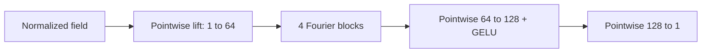

# Architecture specification and verification

All interfaces are `[batch, 1, N] -> [batch, 1, N]`. Inputs/targets share
training-only normalization. Outputs predict the next state directly; there is
no global residual connection, mean correction, or conservation layer. No
coordinate channel is needed for this translation-invariant periodic PDE.

## FNO

Each block sums a Fourier convolution and a learned 1×1 convolution. The
Fourier convolution retains rFFT indices 0–15 with a complex 64×64 weight
matrix per mode. GELU follows the first three blocks. The final block is linear
before projection. No batch normalization, padding, or factorization is used.
These are documented choices within the standard FNO family, not a verbatim
recreation of the original paper's training setup.

Vanilla and physics FNO call the same class and initialize identically for equal
seeds. Their only difference is the loss. Parameter counts count a complex
scalar as two real degrees of freedom.

## U-Net

| Stage | Channels | Length at N=256 |
|---|---:|---:|
| Encoder 1 | 32 | 256 |
| Encoder 2 | 64 | 128 |
| Encoder 3 | 128 | 64 |
| Bottleneck | 256 | 32 |
| Decoder 3 + skip | 128 | 64 |
| Decoder 2 + skip | 64 | 128 |
| Decoder 1 + skip | 32 | 256 |
| Linear output | 1 | 256 |

Each encoder/decoder has two kernel-3 circular convolutions, each followed by
ReLU. Encoders use max pooling by two. Decoders use kernel-2 stride-2 transposed
convolutions and concatenated encoder skips. No normalization or dropout is used.
This is a 1D periodic adaptation of U-Net's encoder–decoder structure.

Higher-resolution primary predictions use Fourier restriction to 256, one
model step, then periodic cubic interpolation, repeated at every rollout step.
Linear interpolation and direct fully-convolutional inference are separate
controls. FNO also receives interpolation controls alongside native inference.

## Tests

Verify forward/backward passes at N=256/512/1024, FFT gradients, microbatch
accumulation equivalence, zero-weight equivalence, and same-backend interrupted
recovery. The hardware doctor compares outputs and physics-loss gradients to
CPU and exercises an Adam update on complex parameters.

References: [FNO](https://arxiv.org/abs/2010.08895),
[U-Net](https://arxiv.org/abs/1505.04597), [PINO](https://arxiv.org/abs/2111.03794).
