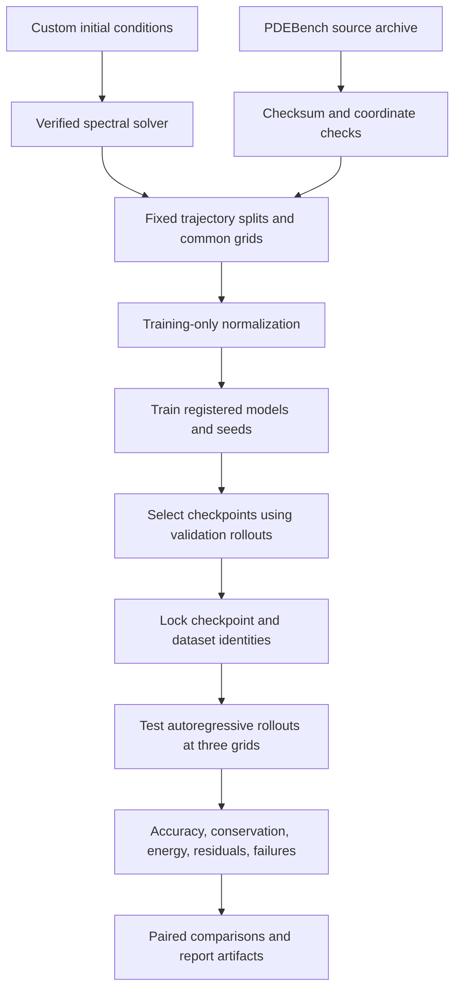
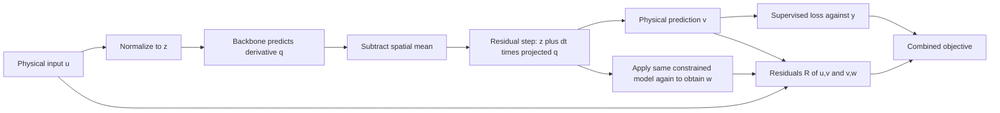

# Minor Project Report

## Physics-Constrained Neural Models for Burgers’ Equation: A Comparative Study of Accuracy, Conservation, and Generalization

Submitted to **[FILL: university name]** in partial fulfilment of the requirements for the award of the degree of **Bachelor of Technology in [FILL: programme]**.

**Under the guidance of:** [FILL: supervisor name, designation, and department]

| Submitted by | Enrolment number |
| --- | --- |
| [FILL: student 1] | [FILL: enrolment number] |
| [FILL: student 2, if applicable] | [FILL: enrolment number] |
| [FILL: student 3, if applicable] | [FILL: enrolment number] |

**[FILL: institute name]**  
**[FILL: institute address and affiliation]**  
**[FILL: submission month and year]**

---

> **Working draft — evidence cutoff: 17 November 2026.** This report contains results from three completed production studies: custom data with 2,000 training trajectories, custom data with 200 training trajectories, and a PDEBench pilot with 200 training trajectories. Results for the constrained U-Net extension and the 600-trajectory PDEBench extension are reserved for later insertion. `[FILL: ...]` marks administrative information; `[PENDING RESULT: ...]` marks incomplete experiments; `[FIGURE TO ADD: ...]` specifies an additional illustration. These markers are intentional and must be resolved or removed before submission. The accompanying [completion checklist](COMPLETION_CHECKLIST.md) records the remaining work. No fixture results are used as scientific evidence.

## Candidate’s Declaration

**Template for author review and signature.**

We, [FILL: student names and enrolment numbers], declare that the work presented in the Minor Project Report entitled **“Physics-Constrained Neural Models for Burgers’ Equation: A Comparative Study of Accuracy, Conservation, and Generalization”** is an authentic record of work carried out by us in the Department of [FILL: department], [FILL: institute], during [FILL: project period], under the guidance of [FILL: supervisor]. Sources of published research, external datasets, and software used in the project are acknowledged in the report.

[FILL: confirm and insert the institute’s prescribed originality and prior-submission declaration.]

| Candidate | Signature | Date |
| --- | --- | --- |
| [FILL: student 1] | ____________________ | __________ |
| [FILL: student 2, if applicable] | ____________________ | __________ |
| [FILL: student 3, if applicable] | ____________________ | __________ |

**Supervisor/HOD certification:** [FILL: prescribed certification text, names, designations, signatures, and dates.]

**Viva-voce record:** [FILL: examination date and examiner/coordinator signatures after examination.]

## Acknowledgement

We express our gratitude to [FILL: supervisor name] for guidance and feedback during the development of this project. We thank [FILL: department/institute and relevant staff] for the facilities and support provided for the work. We acknowledge the researchers who developed the neural architectures and numerical methods on which this study builds, and the PDEBench contributors for making their simulation data publicly available.

[FILL: add specific acknowledgements approved by the authors; confirm names and roles before submission.]

## Abstract

Neural models can approximate the evolution of partial differential equations, but low prediction error does not establish physical conservation or stable long-term behavior. This project examines these properties separately for the one-dimensional periodic viscous Burgers’ equation. A reproducible pipeline compares a periodic U-Net, a Fourier Neural Operator (FNO), an FNO with a soft PDE-residual penalty, and a constrained FNO combining residual time stepping, zero-mean update projection, and a two-step physics penalty. The models have approximately 671,460 real trainable degrees of freedom and are trained for 60 epochs at 256 spatial points. Evaluation covers 100- and 200-step autoregressive rollouts, spatial grids of 256, 512, and 1,024 points, conservation, energy behavior, numerical residuals, and computational cost.

Three completed studies use 2,000 custom training trajectories with two model seeds, 200 custom training trajectories with one seed, and 200 PDEBench training trajectories with two seeds. Each study evaluates 500 test trajectories. On the full custom dataset, the constrained FNO achieves a 100-step mean relative L2 error of 0.00077196, compared with 0.00330765 for the baseline FNO. With 200 custom trajectories, the corresponding errors are 0.00323117 and 0.03244945. On PDEBench, the constrained FNO improves on the baseline FNO, but U-Net gives the lowest mean error: 0.14207152 versus 0.22136138 for constrained FNO. Two constrained-FNO rollouts fail during 200-step PDEBench evaluation for seed 0. The soft penalty does not consistently improve predictive accuracy. Mean projection maintains very small mass drift, but does not guarantee accurate or stable dynamics. The findings support the constrained model on the tested custom distribution while demonstrating that its advantage does not extend uniformly across datasets. Follow-up experiments with constrained U-Net and a larger PDEBench training set remain pending in this draft.

**Keywords:** Burgers’ equation; Fourier Neural Operator; U-Net; physics-informed learning; conservation; autoregressive rollout; PDEBench.

## List of Tables

| Number | Title | Location |
| --- | --- | --- |
| 2.1 | Selected research and its relationship to this project | §2.8 |
| 3.1 | Dataset and study matrix | §3.5 |
| 3.2 | Model definitions and constraint components | §3.6 |
| 3.3 | Training and evaluation settings | §3.8 |
| 4.1 | Accuracy across the three completed studies | §4.1 |
| 4.2 | Full custom-data accuracy and long-horizon results | §4.2 |
| 4.3 | Reduced custom-data accuracy and long-horizon results | §4.3 |
| 4.4 | Matched-seed reduced-data comparison | §4.3 |
| 4.5 | PDEBench pilot accuracy and long-horizon results | §4.4 |
| 4.6 | Reserved constrained U-Net comparison | §4.5 |
| 4.7 | Reserved 600-trajectory PDEBench comparison | §4.6 |
| 4.8 | Identified PDEBench failure cases | §4.7 |
| 4.9 | Mass, energy, and residual diagnostics | §4.8 |
| 4.10 | Native and adapted resolution transfer | §4.9 |
| 4.11 | Reference residuals and oracle interpolation controls | §4.9 |
| 4.12 | Recorded training and validation cost | §4.10 |
| 4.13 | Paired error differences and bootstrap intervals | §4.10 |
| 4.14 | Findings against the research questions | §4.11 |

## List of Figures

| Number | Title | Availability |
| --- | --- | --- |
| 3.1 | End-to-end experimental pipeline | Included: Mermaid diagram |
| 3.2 | Constrained prediction and two-step physics loss | Included: Mermaid diagram |
| 3.3 | Validation rollout histories | Included: PNG and PDF |
| 3.4 | Reference solution examples from both data sources | Reserved: selection instructions in §3.4 |
| 4.1 | Mean prediction error by study | Included: PNG and PDF |
| 4.2 | Reduced-data comparison with matched model seed | Included: PNG and PDF |
| 4.3 | Error accumulation during autoregressive rollouts | Included: PNG and PDF |
| 4.4 | Mass conservation diagnostic | Included: PNG and PDF |
| 4.5 | Energy prediction error | Included: PNG and PDF |
| 4.6 | PDE residual versus prediction error | Included: PNG and PDF |
| 4.7 | Resolution transfer with explicit adapter labels | Included: PNG and PDF |
| 4.8 | Two constrained-FNO failure cases | Included: PNG and PDF |
| 4.9 | Accuracy versus recorded training cost | Included: PNG and PDF |
| 4.10 | Prediction, reference, and absolute-error heatmaps | Reserved: instructions in §4.2 |
| 4.11 | Constrained U-Net comparison | Pending completed evaluation |
| 4.12 | PDEBench 200-versus-600 trajectory comparison | Pending completed evaluation |

Figure numbering follows the thematic groups; some figures are discussed outside numerical order. Final page numbers and diagram rendering should be generated during document layout.

## List of Abbreviations

| Abbreviation | Full form |
| --- | --- |
| PDE | Partial differential equation |
| FNO | Fourier Neural Operator |
| PINN | Physics-Informed Neural Network |
| PINO | Physics-Informed Neural Operator |
| FFT / rFFT | Fast Fourier transform / real-input FFT |
| ETDRK4 | Fourth-order exponential time-differencing Runge–Kutta method |
| MSE | Mean squared error |
| RMS | Root mean square |
| SD | Standard deviation |
| CI | Confidence interval |
| FD | Finite difference |
| MPS | Metal Performance Shaders |
| HDF5 | Hierarchical Data Format, version 5 |

## List of Mathematical Symbols

| Symbol | Meaning |
| --- | --- |
| $u(x,t)$ | Physical solution field |
| $\hat u(x,t)$ | Predicted solution field |
| $\nu$ | Coefficient of viscous diffusion |
| $N$ | Number of spatial grid points |
| $\Delta t$ | Time between stored snapshots and model steps |
| $h$ | Internal numerical-solver timestep |
| $H$ | Evaluation horizon in model steps |
| $\mu,\sigma$ | Training-only normalization mean and standard deviation |
| $z$ | Normalized field $(u-\mu)/\sigma$ |
| $M_\theta$ | Neural network with trainable parameters $\theta$ |
| $R(a,b)$ | Discrete PDE residual between successive fields |
| $\lambda$ | Physics-loss weight |
| $M(t),E(t)$ | Spatial mass integral and kinetic-energy integral |
| $D_x,D_{xx}$ | Discrete first and second spatial derivatives |

## Table of Contents

1. [Introduction](#chapter-1-introduction)
2. [Literature Review](#chapter-2-literature-review)
3. [Methodology and Experimental Design](#chapter-3-methodology-and-experimental-design)
4. [Results and Comparative Analysis](#chapter-4-results-and-comparative-analysis)
5. [Discussion, Conclusion and Future Work](#chapter-5-discussion-conclusion-and-future-work)
6. [References](#references)
7. [Appendix A: Research Paper](#appendix-a-research-paper)
8. [Appendix B: Configuration and Implementation Details](#appendix-b-configuration-and-implementation-details)
9. [Appendix C: Supplementary Results and Figure Specifications](#appendix-c-supplementary-results-and-figure-specifications)
10. [Appendix D: Reproduction and Evidence Index](#appendix-d-reproduction-and-evidence-index)

---

# Chapter 1: Introduction

## 1.1 Background

Many physical models describe how a spatial field evolves over time. A numerical solver approximates this evolution on a grid, repeatedly applying calculations for advection, diffusion, and other physical processes. Such calculations become substantial when many trajectories are required for parameter exploration or repeated prediction. A learned surrogate offers a different computational arrangement: numerical examples are generated in advance, and a network learns an approximate update rule from those examples.

The usefulness of such a model depends on more than its ability to match individual outputs. Small systematic errors can accumulate when predictions become the next inputs. A trajectory can also maintain a physically conserved quantity while developing an incorrect shape or amplitude distribution. This motivates an evaluation in which prediction accuracy, physical consistency, and long-horizon stability are measured separately.

The present project implements this evaluation for the periodic viscous Burgers’ equation. It combines numerical data generation, external-data conversion, controlled model training, and diagnostic reporting in a single reproducible pipeline.

## 1.2 Partial Differential Equations and Burgers’ Equation

Burgers’ equation combines nonlinear transport with viscous diffusion. Its one-dimensional form is sufficiently compact to permit detailed experiments while retaining the interaction between changing gradients and smoothing. In this project, the spatial domain is periodic, so information leaving one end re-enters at the other. The equation and boundary conditions are stated in §3.2.

Two useful physical properties follow directly from the periodic equation: the spatial integral of the field remains constant, and the kinetic-energy integral decreases according to viscous dissipation. These properties provide independent diagnostics of a neural trajectory. The custom dataset and the imported PDEBench dataset use different configured viscosities and initial-condition distributions, enabling evaluation under more than one data-generating regime.

## 1.3 Deep Learning for PDE Prediction

The learning task is next-step prediction. Given a sampled field at time $t$, a model predicts its value at $t+\Delta t$. Supervised training uses adjacent reference snapshots. During deployment-style evaluation, however, the model receives its own previous prediction. This difference between the distribution of training inputs and later rollout inputs makes multi-step evaluation essential.

Our spatial baseline is a periodic one-dimensional adaptation of U-Net. U-Net was originally introduced as a contracting and expanding architecture with connections that preserve spatial detail. This project uses that architectural idea for field evolution rather than image segmentation. [U-Net paper, R1](https://arxiv.org/abs/1505.04597)

## 1.4 Neural Operators and Fourier Neural Operators

Neural operators are designed to learn mappings between functions. FNO implements learned interactions in Fourier space, allowing the same spectral weights to be applied on different spatial grids. The original work evaluates several PDE families and motivates our spectral baseline. [FNO paper, R2](https://arxiv.org/abs/2010.08895)

In this project, the same trained FNO is evaluated at multiple grid sizes. We also test a spatial architecture with interpolation to establish how much of the observed performance can be obtained through ordinary grid conversion. The experimental question concerns measured transfer accuracy; accepting a differently sized tensor is not itself evidence of accurate transfer.

## 1.5 Physics-Informed and Physics-Constrained Learning

Physics can enter learning as a penalty or as an explicit restriction on predictions. PINNs popularized the inclusion of governing-equation residuals in neural-network training. PINO combines operator learning with data and PDE constraints. These works motivate the soft residual objective used here. [PINN authors’ project, R3](https://maziarraissi.github.io/PINNs/), [PINO paper, R4](https://arxiv.org/abs/2111.03794)

We distinguish a **physics-soft FNO**, whose architecture is unchanged and whose objective contains a residual penalty, from a **physics-constrained FNO**, whose prediction rule also projects each update to zero spatial mean. The latter model includes residual stepping and a two-step penalty. Its name refers specifically to this implemented combination; it does not mean that every physical property is enforced.

## 1.6 Autoregressive Prediction and Error Accumulation

An autoregressive rollout repeatedly applies the learned update. Each step can propagate and modify previous errors. A low one-step error therefore does not determine the quality of a 100-step or 200-step trajectory. We examine error over the entire rollout, error beyond the supervised training time window, and explicit failure flags.

The training snapshots extend through $t=1$, while evaluation continues to $t=2$. The longer rollout starts at the original initial condition and is never reset to a reference solution at $t=1$. Thus the extrapolation interval contains accumulated errors from earlier predictions as well as errors generated after the training window.

## 1.7 Problem Statement

The problem is to determine whether adding physics information to a learned Burgers’ update improves its practical behavior under controlled training and evaluation. The study must establish whether an improvement in local PDE-residual satisfaction also corresponds to improved field accuracy, conservation, stability, and grid transfer. It must also identify conditions under which the proposed combination underperforms a simpler baseline.

## 1.8 Research Questions and Objectives

The study addresses five research questions:

1. **RQ1 — Soft physics:** Does adding a fixed soft residual penalty to FNO improve autoregressive prediction and physical diagnostics?
2. **RQ2 — Combined constraints:** Does residual stepping with mean projection and a two-step penalty improve the tested outcomes compared with direct FNO prediction?
3. **RQ3 — Reduced training data:** How do the variants behave when the custom training set is reduced from 2,000 to 200 trajectories under a fixed 60-epoch schedule?
4. **RQ4 — Resolution transfer:** How does native inference at unseen grids compare with inference using interpolation adapters?
5. **RQ5 — External-data behavior:** Does the relative advantage observed on custom data persist when the models are separately trained on the PDEBench pilot?

The constrained U-Net and 600-trajectory extensions investigate whether the combined constraint design helps a different backbone and how the PDEBench comparison changes with a larger training set. Those extensions are not used to answer the completed-study questions until evaluation is available.

## 1.9 Main Contributions

The project contributes a verified custom-data pipeline, capacity-matched neural baselines, a clearly specified constraint package, and an evaluation suite that separates prediction quality from physical diagnostics. The completed experimental evidence includes both full-data and reduced-data custom studies and a separately trained external-data pilot. The reporting explicitly retains failed trajectories and distinguishes model-seed variability from trajectory variability.

The primary contribution is the controlled empirical comparison and its reproducible implementation. This report does not claim to introduce the FNO architecture, U-Net, physics-informed learning, or the general concept of conservative projection.

## 1.10 Applications and Scope

The approach is relevant to the evaluation of learned simulation surrogates, particularly where repeated predictions must remain physically meaningful. The implemented demonstration is restricted to a scalar, one-dimensional, periodic PDE with a fixed timestep within each study. It does not establish performance for multidimensional fluid flow, arbitrary boundaries, changing viscosity at inference, or operational engineering systems. No end-to-end speedup over a numerical solver is claimed without a matched timing experiment.

**Chapter references:** R1–R4 in the reference list.

# Chapter 2: Literature Review

## 2.1 Numerical Methods for Burgers’ Equation

A learned surrogate requires reliable reference trajectories. Kassam and Trefethen describe a stabilized fourth-order exponential time-differencing approach for stiff PDEs. We use ETDRK4 with a Fourier representation for the custom solver, then verify the implementation against temporal refinement, spatial refinement, and an analytic solution. The published numerical method motivates the integrator; the verification results in this report concern our implementation and configuration. [ETDRK4 paper, R5](https://people.maths.ox.ac.uk/trefethen/publication/PDF/2005_111.pdf)

## 2.2 Convolutional Models and U-Net

U-Net combines an encoder that reduces spatial resolution with a decoder that reconstructs detailed outputs using skip connections. It provides the architectural basis for our convolutional comparator. Our implementation changes the original setting to one spatial dimension, periodic padding, and next-state regression. Consequently, results here concern this adaptation and should not be treated as a reproduction of the original segmentation experiments. [U-Net paper, R1](https://arxiv.org/abs/1505.04597)

## 2.3 Fourier Neural Operators

FNO parameterizes a learned operator through Fourier-domain interactions. Its use of retained spectral modes makes it a natural comparator for a periodic PDE and motivates testing at grids beyond the training resolution. Our model is a capacity-matched one-step variant with specified width, mode count, and projection size. Published FNO performance supplies architectural motivation, while all numerical results reported here come from this project’s own training and evaluation. [FNO paper, R2](https://arxiv.org/abs/2010.08895)

## 2.4 Physics-Informed Neural Networks and Operators

PINNs include differential-equation information in the learning objective. PINO extends the combination of data and physics to operator learning, including constraints at resolutions different from the data resolution. Our soft model is a more specific grid-based adaptation: it uses a discrete conservative residual on successive predicted fields. It does not reproduce the full PINO training procedure. This distinction is important because the effectiveness of a physics penalty depends on the residual discretization, objective scaling, and optimization protocol. [PINN authors’ project, R3](https://maziarraissi.github.io/PINNs/), [PINO paper, R4](https://arxiv.org/abs/2111.03794)

## 2.5 Soft Penalties and Explicit Conservation

Cardoso-Bihlo and Bihlo investigate projection-based exactly conservative neural methods for dynamical systems. Their work illustrates the distinction between encouraging a property in the loss and restricting predictions to satisfy an invariant. Our projection is tailored to the spatial mean of periodic Burgers’ updates. It is not a general invariant-manifold solver, and its effect on accuracy must be measured separately from its algebraic conservation property. [Conservative-network paper, R6](https://arxiv.org/abs/2311.14131)

## 2.6 Long-Horizon Stability and Resolution Generalization

For the present task, two evaluation choices are particularly consequential. First, the predicted trajectory must remain autoregressive over the complete horizon; periodically substituting reference states would change the task. Second, a resolution comparison must state whether a network runs directly on the target grid or on an interpolated version of the training grid. These are design requirements of our comparison. They prevent an architecture’s interface flexibility or a short-time average from being mistaken for demonstrated long-term predictive reliability.

## 2.7 PDE Datasets and PDEBench

PDEBench provides simulation datasets, generation code, and baseline methods for scientific machine learning across several PDE families. It gives this project an external numerical source beyond the custom solver. We use one Burgers archive with a documented reduced training set and custom split. The resulting pilot measures our models under our preprocessing and training rules; it is not a reproduction of an official leaderboard score. [PDEBench paper, R7](https://arxiv.org/abs/2210.07182)

## 2.8 Comparison with Selected Published Studies

**Table 2.1. Selected research and its relationship to this project.** This table describes the specific ideas used here, rather than asserting that the cited studies omit other capabilities.

| Work | Relevant contribution | Use in this project | Boundary of our comparison |
| --- | --- | --- | --- |
| Ronneberger et al., U-Net [R1] | Encoder–decoder with skip connections | Periodic 1D spatial baseline | Different task and dimensionality |
| Li et al., FNO [R2] | Fourier-domain neural operator | Spectral baseline and native grid transfer | Our width, training rule, and datasets |
| Raissi et al., PINN [R3] | Governing equations in neural learning | Motivation for residual penalties | Grid residuals rather than coordinate-based solution fitting |
| Li et al., PINO [R4] | Data and physics in operator learning | Motivation for soft-physics FNO | No claim to reproduce the full PINO procedure |
| Kassam and Trefethen [R5] | Stabilized ETDRK4 integration | Custom reference solver | Independently checked implementation |
| Cardoso-Bihlo and Bihlo [R6] | Conservation through projection | Motivation for explicit invariant preservation | Projection of one spatial mean |
| Takamoto et al., PDEBench [R7] | External simulation benchmark suite | Imported Burgers pilot | Custom split and Fourier grid conversion |

## 2.9 Research Gaps Addressed by This Project

The project is organized around gaps in the evidence needed for its own practical claims. A low residual alone leaves the quality of the predicted field unresolved. A mass-preserving update leaves energy behavior and stability unresolved. A successful custom-data result leaves external-data performance unresolved. Native execution at a larger grid leaves the contribution of interpolation and reference smoothness unresolved.

Our study addresses these questions jointly using the same saved trajectories, explicit model definitions, and comparable training settings. The completed matrix does not isolate every component of the constrained design or sweep physics-loss weights. Those questions remain future work, rather than being implied by the literature review or the original proposal.

**Chapter references:** R1–R7 in the reference list.

# Chapter 3: Methodology and Experimental Design

## 3.1 Overall Research Pipeline

The pipeline separates data preparation, training, checkpoint selection, and test evaluation. Custom trajectories are generated and numerically checked before training. External trajectories are converted with their provenance retained. Training-only normalization is fixed for each study. Every registered model completes its prescribed training before selected checkpoints are released for test evaluation. Evaluation records are then summarized into tables and figures.



*Figure 3.1. Experimental pipeline. Custom numerical verification and external-data conversion are separate procedures. Both feed a common training and diagnostic workflow.*

The completed studies are identified by their saved production artifacts, rather than by the larger experiments proposed in early project documents. Earlier pilot runs and small integration fixtures remain useful development records but are not pooled with the results in Chapter 4.

## 3.2 Mathematical Formulation

The equation is

$$
\frac{\partial u}{\partial t}+\frac{\partial}{\partial x}\left(\frac{u^2}{2}\right)
=\nu\frac{\partial^2u}{\partial x^2},\qquad x\in[0,1),\quad t\in[0,2],
$$

with periodic boundary conditions and an initial field $u(x,0)=u_0(x)$. On a unit-length domain, discrete spatial means approximate the corresponding integrals directly.

Integrating the equation over space eliminates periodic derivative terms, giving

$$
M(t)=\int_0^1u(x,t)\,dx,\qquad \frac{dM}{dt}=0.
$$

Multiplying by $u$ and integrating by parts gives

$$
E(t)=\frac12\int_0^1u(x,t)^2\,dx,\qquad
\frac{dE}{dt}=-\nu\int_0^1u_x(x,t)^2\,dx\leq0.
$$

These identities motivate mass drift and energy-dissipation diagnostics. They do not uniquely determine the solution: many inaccurate fields can share the correct mean, and a decreasing energy curve can still disagree with the reference trajectory.

## 3.3 Custom Dataset Generation and Numerical Verification

The custom solver uses a Fourier pseudo-spectral spatial discretization and ETDRK4 time integration. It evaluates the nonlinear flux on a grid padded to $3N/2$ before projection, reducing aliasing in the quadratic product. The reference grid has 8,192 points and uses double precision. Stored model grids contain 256, 512, and 1,024 points, obtained by Fourier projection. The output interval is $\Delta t=0.01$, with 201 snapshots from $t=0$ through $t=2$.

The initial field is a random Fourier series with 64 nonzero modes plus a random spatial mean. The cosine and sine coefficients are independent Gaussian draws with mode variance proportional to

$$
v_k=\left((2\pi k)^2+25\right)^{-2},\qquad k=1,\ldots,64.
$$

A common scale sets the expected mean-square amplitude of the fluctuating field to $0.5^2$; individual realizations are not each rescaled to exactly that RMS. The mean is drawn uniformly from $[-0.5,0.5]$. The custom viscosity is $\nu=0.01$.

Before production generation, the solver compares timesteps $h$ and $h/2$ at 8,192 points and grids of 8,192 and 16,384 points at the refined timestep. The permitted maximum snapshot RMS discrepancy, normalized by initial RMS, is $10^{-5}$. Additional checks cover mass drift, positive energy increments, and an analytic periodic Cole–Hopf solution. The saved verification passed with $h=0.001$. Across four development seeds, the largest recorded temporal discrepancy was approximately $5.87\times10^{-9}$ and the largest spatial discrepancy was $4.23\times10^{-16}$. The analytic error was approximately $1.04\times10^{-13}$.

These measurements establish numerical agreement on the checked configurations, rather than exact mathematical ground truth for every realization. Production trajectories also undergo finite-value, mass, and energy checks. The reference should therefore be described as a **validated numerical approximation**. The numerical method is based on [ETDRK4, R5](https://people.maths.ox.ac.uk/trefethen/publication/PDF/2005_111.pdf); the recorded checks are available in [solver verification](../artifacts/eight-run/full/verification/solver.json).

## 3.4 PDEBench Acquisition and Preprocessing

The external study uses the checksum-verified PDEBench v8 archive `1D_Burgers_Sols_Nu0.001.hdf5`, containing 10,000 trajectories with 201 solution snapshots and 1,024 spatial points. The source file is retained unchanged. Converted data use the same 0.01 time interval and the first 201 matching time coordinates. The unmatched extra coordinate present in the source time array is excluded after validation.

The source grid is periodic and cell-centered. Fourier resampling produces the 256- and 512-point grids while preserving the physical origin of the supplied samples; the 1,024-point field is unchanged. This preprocessing is not the default subsampling used in every PDEBench experiment. Our scores must therefore be interpreted with the stated conversion and split.

The configured diffusion coefficient is $\nu=0.001/\pi\approx0.00031831$, following the generator convention documented in the project’s compatibility audit. The exact generator commit associated with this particular archive has not been independently established. Reference residual diagnostics are retained so that possible discretization or convention mismatches remain visible. The imported data receive conversion and integrity checks; they do not receive a fabricated custom-solver verification certificate. These decisions and upstream links are recorded in the [PDEBench compatibility document](../docs/pdebench.md).

The pilot uses source indices 0–199 for training, 8750–8999 for validation, and every other index from 9000 through 9999 for 500 test trajectories. All models in the pilot are trained from scratch. This is a separate training study, rather than a transfer test of custom-data checkpoints on PDEBench.

> **[FIGURE TO ADD: Figure 3.4 — reference examples.]** Add one heatmap and initial/final field profiles for the first test trajectory in each dataset (`test-00000` for custom data and `test-09000` for PDEBench), using $N=256$. Label the trajectory IDs, viscosity, grid, and separate color scales. Selecting the first stored IDs avoids choosing unusually favorable examples. These are illustrative examples, not evidence of the complete distribution’s sharpness or complexity.

## 3.5 Dataset Splits, Normalization, and Experimental Matrix

The custom archive contains 2,000 training, 250 validation, and 500 test trajectories. The reduced-data experiment selects 200 training trajectories using subset seed 1729 and reuses the same validation and test trajectories. A fixed subset is shared across the four model variants. The custom reduced-data study has one completed model seed; the full custom study and PDEBench pilot each have two.

For each study, a scalar mean $\mu$ and standard deviation $\sigma$ are fitted only on its selected training trajectories at $N=256$ through $t=1$. Validation fields, test fields, higher-resolution grids, and later times do not influence these statistics. The normalized input is $z=(u-\mu)/\sigma$. The reduced-data study recomputes normalization from its 200 selected trajectories.

**Table 3.1. Dataset and study matrix at the draft cutoff.** All listed studies use 250 validation and 500 test trajectories.

| Study | Training trajectories | Model seeds | Models | Status used in this report |
| --- | --- | --- | --- | --- |
| Custom full data | 2,000 | 0, 1 | U-Net, FNO, soft FNO, constrained FNO | Complete: 8 runs |
| Custom reduced data | 200 | 0 | Same four variants | Complete: 4 runs |
| PDEBench pilot | 200 | 0, 1 | Same four variants | Complete: 8 runs |
| PDEBench constrained U-Net extension | 200 | 0, 1 | Constrained U-Net | Pending full evaluation |
| PDEBench larger-data extension | 600 | 0, 1 | U-Net, FNO, constrained U-Net | Pending full evaluation |

The larger-data extension includes the original 200 PDEBench training trajectories within its 600-trajectory set. Its normalization is recalculated from the larger set. The follow-ups retain the earlier held-out examples and were selected after inspection of earlier results; they are exploratory extensions, not independent confirmation experiments.

## 3.6 Model Architectures

### 3.6.1 Periodic U-Net

The U-Net accepts a tensor of shape `[batch, 1, N]` and returns the same shape. Encoder channel widths are 32, 64, 128, and 256. Each stage contains two kernel-three circular convolutions followed by ReLU activations. Three max-pooling operations reduce spatial length. Transposed convolutions restore the resolution, and concatenated skip features connect matching encoder and decoder levels. A final pointwise convolution returns one output channel. The model contains 671,457 trainable parameters.

### 3.6.2 Capacity-Matched FNO

The FNO lifts the scalar field to 71 channels, applies four spectral blocks retaining 16 rFFT modes, and projects through 77 channels to one output channel. Each block combines a learned spectral convolution with a pointwise linear convolution; GELU follows the first three blocks. Complex weights are counted as two real degrees of freedom, giving 671,460 parameters. The three FNO variants use the same backbone specification, and equal seeds pair their backbone initialization and training-pair ordering.

The three-parameter difference between U-Net and FNO is negligible in count, but it does not imply equal inductive bias, optimization difficulty, or compute. In particular, constrained training requires a second model prediction to evaluate its loss.

**Table 3.2. Model definitions.**

| Report label | Artifact family | Output rule | Mean projection | Physics penalty |
| --- | --- | --- | --- | --- |
| U-Net | `unet` | Direct next normalized state | No | None |
| FNO | `fno` | Direct next normalized state | No | None |
| Soft FNO | `physics-soft` | Direct next normalized state | No | One transition, spectral, $\lambda=1$ |
| Constrained FNO | `physics-constrained` | Residual normalized derivative update | Yes | Two transitions, spectral, $\lambda=1$ |
| Constrained U-Net | `unet-constrained` | Same constrained wrapper on U-Net | Yes | Two transitions, spectral, $\lambda=1$; results pending |

## 3.7 Physics Loss and Constrained Prediction

For physical fields $a$ and $b$ separated by $\Delta t$, the discrete residual is

$$
R(a,b)=\frac{b-a}{\Delta t}
+\frac{D_x(a^2/2)+D_x(b^2/2)}{2}
-\nu\frac{D_{xx}a+D_{xx}b}{2}.
$$

The spectral derivative implementation uses a dealiased quadratic flux. A second-order centered finite-difference version is also evaluated as a diagnostic. Both forms differentiate the conservative flux, and their spatial derivative sums vanish under periodic boundaries. The training studies reported here use spectral losses; the two diagnostics do not constitute a training-discretization sweep.

For physical input $u$, reference next state $y$, and prediction $v$, the supervised objective is

$$
\mathcal L_{\mathrm{data}}=\operatorname{mean}\left[\left(\frac{v-y}{\sigma}\right)^2\right].
$$

The soft model adds

$$
\mathcal L_{\mathrm{physics,1}}=
\operatorname{mean}\left[\left(\frac{\Delta t\,R(u,v)}{\sigma}\right)^2\right],
\qquad \mathcal L=\mathcal L_{\mathrm{data}}+\lambda\mathcal L_{\mathrm{physics,1}}.
$$

The constrained model predicts a normalized derivative $q=M_\theta(z)$ and forms

$$
q_0=q-\operatorname{mean}_x(q),\qquad
z_{\mathrm{next}}=z+\Delta t\,q_0,\qquad
v=\mu+\sigma z_{\mathrm{next}}.
$$

Because $q_0$ has zero spatial mean, the update preserves the mean algebraically. Floating-point accumulation can still produce small drift. Neither energy dissipation nor prediction error is fixed by this projection.

Applying the same model again produces $w$, and constrained training uses

$$
\mathcal L_{\mathrm{physics,2}}=\frac12\left\{
\operatorname{mean}\left[\left(\frac{\Delta t\,R(u,v)}{\sigma}\right)^2\right]
+\operatorname{mean}\left[\left(\frac{\Delta t\,R(v,w)}{\sigma}\right)^2\right]\right\}.
$$

The total objective is $\mathcal L_{\mathrm{data}}+\lambda\mathcal L_{\mathrm{physics,2}}$, with $\lambda=1$. Gradients propagate through both predictions. Only the first step has a supervised target; no second reference target is used. For the final supervised pair ending at $t=1$, the second physics-only prediction reaches $t=1.01$.



*Figure 3.2. The constrained prediction rule and training objective. The second prediction is differentiable and has no additional supervised target.*

The comparison between FNO and soft FNO isolates the added soft loss within the paired backbone. The comparison involving constrained FNO changes three elements together: residual stepping, projection, and the number of physics transitions. It therefore measures the combined design, not each component’s causal contribution.

## 3.8 Training Protocol and Checkpoint Selection

All completed studies use Adam with zero weight decay, an effective batch of 256, and 60 epochs. Gradient accumulation permits a microbatch of 64 while retaining the effective batch size. Training uses all adjacent snapshot pairs through $t=1$. There are 200,000 pairs per epoch in the full custom study and 20,000 in each 200-trajectory study.

The learning rate starts at $3\times10^{-4}$ and follows an epoch-wise cosine schedule whose configured minimum is $3\times10^{-6}$. The minimum is reached by the scheduler after the final epoch. Validation runs every two epochs and selects the checkpoint with the lowest 100-step mean rollout error. Test evaluation uses this selected checkpoint, rather than automatically using the final training state.

**Table 3.3. Shared training and evaluation settings.**

| Setting | Value |
| --- | --- |
| Training spatial grid | $N=256$ |
| Supervised time interval | $0\leq t\leq1$ |
| Model/output timestep | $\Delta t=0.01$ |
| Training epochs | 60 |
| Optimizer | Adam, weight decay 0 |
| Effective batch / microbatch | 256 / 64 |
| Initial / configured minimum learning rate | $0.0003$ / $0.000003$ |
| Validation frequency and criterion | Every 2 epochs; mean 100-step rollout error |
| Physics weight | 1 for the soft and constrained variants |
| Test grids | 256, 512, 1,024 |
| Test horizons | 100 and 200 steps |
| Bootstrap replicates | 10,000 paired resamples |
| Completed-study backend | PyTorch MPS |

The saved full custom runs contain 46,920 optimizer updates each, compared with 4,740 in the 200-trajectory runs. Equal epochs therefore do not mean equal update count. The 600-trajectory extension specifies 14,100 updates per completed run.


*Figure 3.3. Validation error across training epochs. Solid lines show seed 0 and dashed lines show seed 1 where available. These are validation histories, not test learning curves. Each run’s minimum validation score determines its selected checkpoint.*

## 3.9 Evaluation Metrics and Failure Criteria

For each trajectory, let $\rho_0$ be its initial reference RMS, floored at $10^{-12}$. At time index $k$, the relative field error is

$$
e_k=\frac{\operatorname{RMS}(\hat u_k-u_k)}
{\max\{\operatorname{RMS}(u_k),10^{-8}\rho_0,10^{-12}\}}.
$$

The main rollout score averages $e_k$ over steps 1 through $H$, then over test trajectories and model seeds. Terminal error uses only step $H$. At $H=200$, the extrapolation score averages only steps 101–200. Thus the 200-step score covers both the training-time interval and the later interval, while the extrapolation score isolates $t>1$ within the same uninterrupted rollout.

Mass drift is the maximum absolute difference between predicted spatial mean and its initial value, divided by $\rho_0$. It uses initial field RMS rather than initial mean as its denominator, avoiding division by a nearly zero mean. Energy error is the time average of the absolute difference between predicted and reference kinetic energies. It is not a relative energy error. The dissipation-balance diagnostic measures the maximum magnitude of

$$
E(t)-E(0)+\int_0^t\nu\,\operatorname{mean}_x\big[(D_x\hat u)^2\big]\,d\tau,
$$

with a trapezoidal time integral. Spectral and finite-difference residual metrics are the time mean of the spatial RMS residual. These reported diagnostic residuals are not the normalized squared quantities used in the training loss.

A rollout fails if any predicted field becomes nonfinite or its RMS exceeds 100 times the initial reference RMS. Once failure occurs, later steps remain failed. At a horizon containing a failure, the affected group’s aggregate metric is unavailable under the reporting rule; failed trajectories are not silently dropped. The failure rate is reported separately. A low failure rate does not exclude large but finite errors below this threshold.

## 3.10 Resolution Transfer and Interpolation Controls

Every model is evaluated natively at each grid. Additional adapted evaluations restrict the current field to 256 points, apply one model update, and interpolate back to the evaluation grid. The process repeats at every autoregressive step. Periodic cubic and linear interpolation are evaluated separately.

The principal high-resolution comparison in this report explicitly includes native U-Net and cubic-adapted U-Net alongside native FNO variants. The training-grid score at $N=256$ is shared because the adapter has no grid change to perform. Adapter labels are retained in all comparisons so that apparent grid transfer is not attributed to a backbone when it depends on interpolation.

Reference controls evaluate the numerical trajectories with the same residual diagnostics. Persistence controls hold the initial field fixed. Oracle interpolation controls interpolate reference fields from the coarse grid independently at each time, rather than learning or rolling out a model. They measure interpolation error only and are not deployable forecasting models.

## 3.11 Statistical Comparisons

The saved summaries report the mean of trajectory-averaged seed scores and, where at least two model seeds exist, their sample standard deviation. This SD describes between-seed variation. It is not the variability of all individual trajectories and is not a confidence interval for the mean.

Paired comparisons resample model seeds and matching test-trajectory IDs with replacement, using 10,000 replicates. The same resampled indices are applied to both models in a comparison; timesteps are not treated as independent replicates. The percentile interval is descriptive. Two seeds provide limited information about the training distribution, and a one-seed interval measures trajectory uncertainty conditional on that trained model. A single-seed SD is **not estimable**, which must not be confused with a failed rollout.

## 3.12 Implementation and Reproducibility

The implementation uses Python and PyTorch for models and training, NumPy and SciPy for numerical operations, HDF5 for trajectory storage, and Matplotlib for plots. Completed runs record source snapshots, configurations, dataset identities, normalization, selected checkpoint hashes, run histories, evaluation contexts, and metric-file hashes. Resume checkpoints retain optimizer, scheduler, and random-state information.

Training and validation times are read from completed run records on the MPS backend. They include validation and checkpoint overhead and should not be interpreted as isolated network-kernel timings. Exact processor model and installed physical memory are left for verified machine metadata: **[FILL: hardware model and RAM for the experimental machine]**.

The report figures are generated from saved evaluations and summaries. Creating this document does not launch training, replace checkpoints, or alter the ongoing follow-up experiments. Source and reproduction details appear in Appendix D.

**Chapter references:** R1–R7; project implementations in `src/burgers_research/`; frozen production configurations and evaluation records listed in Appendix D.

# Chapter 4: Results and Comparative Analysis

## 4.1 Overview of Completed Experiments

This chapter reports 20 completed training runs across three studies. Unless stated otherwise, numerical comparisons use native inference at $N=256$ and a mean over the first 100 predicted steps. Each seed is evaluated on 500 trajectories. The full custom and PDEBench studies average seeds 0 and 1; the reduced custom study contains seed 0 only. Smaller errors indicate better performance.

**Table 4.1. Mean rollout relative L2 error at $N=256$, 100 steps.** Columns describe different training studies and should not be interpreted as a paired cross-dataset test.

<!-- BEGIN GENERATED headline -->

| Model | Custom 2,000 (2 seeds) | Custom 200 (seed 0) | PDEBench 200 (2 seeds) |
| --- | --- | --- | --- |
| U-Net | 0.0030780826 | 0.023217069 | 0.14207152 |
| FNO | 0.0033076495 | 0.032449453 | 0.27232642 |
| Soft FNO | 0.003807557 | 0.032493951 | 0.35230659 |
| Constrained FNO | 0.00077196435 | 0.0032311664 | 0.22136138 |

<!-- END GENERATED headline -->


*Figure 4.1. The four model variants across the three completed studies. Error bars show sample SD across two model seeds where available. The single-seed reduced-data panel has no estimated seed variability. Panels use different vertical scales to retain readable within-study differences.*

The constrained model leads on both custom-data studies. The ordering changes on PDEBench: U-Net has the lowest mean error, followed by constrained FNO, baseline FNO, and soft FNO. This change is central to the interpretation of the project, because it limits any claim that the combined constraint package is uniformly superior.

## 4.2 Custom Dataset: 2,000 Training Trajectories

**Table 4.2. Full custom-data results at $N=256$.** Means and SD refer to two model seeds. Failure percentages pool the two sets of 500 evaluated seed–trajectory cases.

<!-- BEGIN GENERATED custom2000 -->

| Model | 100-step mean | 100-step seed SD | 200-step mean | t > 1 mean | 200-step failures |
| --- | --- | --- | --- | --- | --- |
| U-Net | 0.0030780826 | 0.000799512 | 0.0050067053 | 0.0069353279 | 0.00% |
| FNO | 0.0033076495 | 0.000464465 | 0.0052880611 | 0.0072684726 | 0.00% |
| Soft FNO | 0.003807557 | 0.000183787 | 0.0062691233 | 0.0087306897 | 0.00% |
| Constrained FNO | 0.00077196435 | 5.07065e-05 | 0.00085789531 | 0.00094382628 | 0.00% |

<!-- END GENERATED custom2000 -->

The constrained FNO obtains a 100-step error of 0.00077196, approximately 76.7% below baseline FNO. Its error remains low over 200 steps, with a mean of 0.00085790. The later-window error is 0.00094383, showing that its advantage persists after the supervised time interval under this test distribution.

U-Net slightly outperforms direct FNO in the two-seed 100-step average. The difference is small relative to the variation visible in the seed scores, so the ranking alone should not be presented as a broad architectural conclusion. Soft FNO produces a larger error than direct FNO at both horizons despite reducing the average spectral residual. This is the first direct example in the results of residual improvement without improved field prediction.

No failures are reported for these custom test evaluations. This statement applies to the saved trajectories, grids, adapters, and horizons; it is not a proof of indefinite stability. The smoothness suggested by the interpolation controls in §4.9 also limits the difficulty of the grid-transfer task.

> **[FIGURE TO ADD: Figure 4.10 — reference and prediction heatmaps.]** Use the first custom test trajectory (`test-00000`), seed 0, $N=256$, and the saved best checkpoint for each of the four variants. Show reference and prediction heatmaps over $0\leq t\leq2$ with a shared field color scale, followed by absolute-error heatmaps with clearly labeled scales. Add vertical or horizontal lines at $t=1$, depending on the plot orientation. Record checkpoint identities. Include a separate PDEBench example with its own scale. Do not select an example based on which model looks best. Figure 4.8 already documents the identified failure trajectories.

## 4.3 Reduced Custom Dataset: 200 Training Trajectories

**Table 4.3. Reduced custom-data results at $N=256$, seed 0.** Between-seed SD cannot be estimated. All reported trajectories remain within the configured failure threshold.

<!-- BEGIN GENERATED custom200 -->

| Model | 100-step mean | 100-step seed SD | 200-step mean | t > 1 mean | 200-step failures |
| --- | --- | --- | --- | --- | --- |
| U-Net | 0.023217069 | Not estimable (one seed) | 0.035115362 | 0.047013655 | 0.00% |
| FNO | 0.032449453 | Not estimable (one seed) | 0.050429698 | 0.068409944 | 0.00% |
| Soft FNO | 0.032493951 | Not estimable (one seed) | 0.050301331 | 0.068108711 | 0.00% |
| Constrained FNO | 0.0032311664 | Not estimable (one seed) | 0.0042608708 | 0.0052905752 | 0.00% |

<!-- END GENERATED custom200 -->

With 200 training trajectories, constrained FNO achieves a 100-step error of 0.00323117, approximately 90.0% below the baseline FNO error of 0.03244945. Its advantage also appears at 200 steps. U-Net gives the second-lowest error, while soft FNO and direct FNO are nearly equal in the 100-step metric.

For a reduction comparison, the full-data seed-0 score is the appropriate counterpart to the reduced-data seed-0 score. Comparing the one-seed result directly against a two-seed full-data average would introduce an unnecessary difference in the seed mixture.

**Table 4.4. Matched-seed reduction from 2,000 to 200 custom training trajectories.** All entries use seed 0, 100 steps, and $N=256$.

<!-- BEGIN GENERATED lowdata -->

| Model | 2,000 trajectories, seed 0 | 200 trajectories, seed 0 | Error multiplier |
| --- | --- | --- | --- |
| U-Net | 0.0036434232 | 0.023217069 | 6.37× |
| FNO | 0.0029792234 | 0.032449453 | 10.89× |
| Soft FNO | 0.0039375139 | 0.032493951 | 8.25× |
| Constrained FNO | 0.00080781928 | 0.0032311664 | 4.00× |

<!-- END GENERATED lowdata -->


*Figure 4.2. Errors for the two tested custom training-set sizes, using seed 0 in both cases. Connecting lines guide the eye between two measured settings; they are not a fitted learning curve. Training lasts 60 epochs in each setting, so both data diversity and update count change.*

Every model degrades with the smaller training set, but constrained FNO has the smallest error multiplier in this seed. The finding supports its usefulness under the tested limited-data schedule. It does not isolate sample efficiency: update counts fall from 46,920 to 4,740, normalization is refitted, and only one subset and model seed are represented. Additional seeds and an equal-update or equal-compute study are needed to separate these influences.

## 4.4 PDEBench Pilot: 200 Training Trajectories

**Table 4.5. PDEBench pilot results at $N=256$, seeds 0 and 1.** “Unavailable” denotes a failed-rollout group under the reporting policy, rather than an unperformed experiment.

<!-- BEGIN GENERATED pdebench -->

| Model | 100-step mean | 100-step seed SD | 200-step mean | t > 1 mean | 200-step failures |
| --- | --- | --- | --- | --- | --- |
| U-Net | 0.14207152 | 0.00568777 | 0.19750082 | 0.25293013 | 0.00% |
| FNO | 0.27232642 | 0.00552291 | 0.37006495 | 0.46780349 | 0.00% |
| Soft FNO | 0.35230659 | 0.000845943 | 0.47492117 | 0.59753576 | 0.00% |
| Constrained FNO | 0.22136138 | 0.0255744 | Unavailable: failed rollout(s) | Unavailable: failed rollout(s) | 0.20% |

<!-- END GENERATED pdebench -->

U-Net gives the lowest 100-step mean error, 0.14207152. Constrained FNO improves on direct FNO by approximately 18.7%, but its error is approximately 55.8% higher than U-Net’s. Soft FNO gives the largest mean error among the tested variants. Consequently, the positive custom-data result does not justify a dataset-independent claim of constrained-FNO superiority.

The 200-step constrained-FNO aggregate is unavailable because two trajectories fail for seed 0. The remaining models have finite aggregate scores. Seed 1 of constrained FNO completes without failure and has a 200-step mean of approximately 0.21567, but presenting that seed alone as the model’s overall result would remove unfavorable evidence. The two-seed failure rate and unavailable aggregate are retained.

The custom-200 and PDEBench-200 results also show that matching training counts does not eliminate their performance gap. However, the studies differ in viscosity, initial-condition distribution, numerical source, and reference resolution. The gap cannot be attributed exclusively to one of those factors. The configured PDEBench convention and discrete residual compatibility remain relevant qualifications.

## 4.5 Constrained U-Net Follow-Up — Results Pending

The extension applies the same residual stepping, zero-mean update projection, and two-step spectral physics loss to the periodic U-Net. It trains seeds 0 and 1 on the PDEBench pilot’s 200 training trajectories, retaining the same split, normalization, schedule, and checkpoint-selection rule. The wrapper adds no trainable parameters.

This experiment addresses a specific uncertainty: whether the combined constraint design helps the strongest baseline architecture on the external-data pilot. It still tests the components together and therefore cannot isolate the individual effect of projection or residual stepping.

**[PENDING RESULT: CONSTRAINED_UNET_200]** At the recorded drafting snapshot, the runner was in the training stage and a complete evaluated report was not available. Insert results only after both seeds, all evaluation stages, and summary generation are complete. Current status may advance after this document is written.

**Table 4.6. Reserved constrained U-Net comparison at $N=256$.**

| Model | Seeds | 100-step error ± seed SD | 200-step error | $t>1$ error | Mass drift | Failures |
| --- | --- | --- | --- | --- | --- | --- |
| U-Net, 200 trajectories | 0, 1 | See Table 4.5 | See Table 4.5 | See Table 4.5 | See Table 4.9 | See Table 4.5 |
| Constrained U-Net, 200 trajectories | 0, 1 | PENDING | PENDING | PENDING | PENDING | PENDING |

> **[FIGURE TO ADD: Figure 4.11 — constrained U-Net comparison.]** Show plain versus constrained U-Net rollout-error curves and normalized maximum mass drift. Add energy error and seed-wise scores to the accompanying table. For higher grids, compare native with native or cubic with cubic; the original plain-U-Net report and the new standalone constrained-U-Net report do not necessarily choose the same headline adapter.

**[PENDING RESULT: CONSTRAINED_UNET_INTERPRETATION]** Insert a paragraph describing the direction and magnitude of the result, including unfavorable outcomes, any failures, and computational cost. Update the abstract and conclusion only after this analysis.

## 4.6 PDEBench Extension: 600 Training Trajectories — Results Pending

The larger-data extension registers plain U-Net, plain FNO, and constrained U-Net with two seeds each. All six models train from scratch on 600 trajectories for 60 epochs. Validation and test IDs remain fixed, and the original 200 training examples are contained in the larger training set. The protocol uses the same base grid and learning-rate schedule, with 14,100 optimizer updates per run.

**[PENDING RESULT: PDEBENCH_600]** At the recorded drafting snapshot, the execution was waiting for the preceding constrained-U-Net study. There is no completed performance claim for this extension in the present report.

**Table 4.7. Reserved 600-trajectory comparison at $N=256$.**

| Model | Seeds | 100-step error ± seed SD | 200-step error | $t>1$ error | Failure rate | Training + validation time |
| --- | --- | --- | --- | --- | --- | --- |
| U-Net | 0, 1 | PENDING | PENDING | PENDING | PENDING | PENDING |
| FNO | 0, 1 | PENDING | PENDING | PENDING | PENDING | PENDING |
| Constrained U-Net | 0, 1 | PENDING | PENDING | PENDING | PENDING | PENDING |

> **[FIGURE TO ADD: Figure 4.12 — PDEBench data-budget comparison.]** Compare 200 and 600 training trajectories for each available matched model and seed. Label the change in optimizer updates and normalization. Plot all three models at 600 trajectories and include constrained U-Net at 200 only after its evaluation completes. Do not insert a 600-trajectory constrained-FNO result: that model is not registered in this extension.

Because this experiment follows inspection of the earlier test results and reuses held-out examples, it supports an exploratory comparison. An untouched confirmation set would be needed for a stronger independent validation claim.

## 4.7 Long-Horizon Accuracy and Failure Cases


*Figure 4.3. Mean per-time relative L2 error across all test trajectories and available seeds at $N=256$. The dashed line marks the end of the supervised training window. The PDEBench constrained-FNO mean stops at the first failed trajectory; later means are not computed from survivors alone. The logarithmic vertical scale makes both small custom-data errors and later error growth visible.*

The custom constrained model remains accurate after $t=1$ in both training-size studies. The PDEBench result is more heterogeneous: a lower 100-step mean than direct FNO coexists with severe outliers and later failures. This difference demonstrates why an average over the training-time interval is not sufficient to establish stable extrapolation.

**Table 4.8. Failed PDEBench constrained-FNO trajectories at $N=256$.** The first failed step is inferred from the first unavailable relative-error entry in the saved curve. The saved representation does not distinguish threshold overflow from a nonfinite predicted field.

<!-- BEGIN GENERATED failures -->

| Test trajectory | Seed | First failed step | First failed time | 100-step mean error |
| --- | --- | --- | --- | --- |
| test-09012 | 0 | 170 | 1.70 | 0.461127 |
| test-09652 | 0 | 116 | 1.16 | 5.80429 |

<!-- END GENERATED failures -->


*Figure 4.8. Relative error before failure for the two identified seed-0 PDEBench test trajectories. Red dashed lines identify the first failed step. Curves end before that step; missing values are not replaced by zero or connected across the failure.*

There are two failures among 500 trajectories for seed 0 and none for seed 1. The pooled rate is therefore 2/1,000 seed–trajectory cases, or 0.2%; the denominator does not represent 1,000 unique test initial conditions. The trajectory `test-09652` already has a 100-step mean error of approximately 5.8043, an energy error of 267.3247, and a spectral residual of 129,828.84. It is a severe outlier before the formal failure flag. Retaining it explains why the aggregate energy and residual diagnostics can be poor even while the mean conservation remains excellent.

## 4.8 Mass Conservation, Energy Behavior, and PDE Residuals

**Table 4.9. Physical diagnostics at $N=256$, 100 steps.** Values are averaged over trajectories and the available seeds. Energy error is an absolute energy difference; residual values use physical fields and are not normalized across datasets.

<!-- BEGIN GENERATED physics -->

| Study | Model | Normalized maximum mass drift | Energy error | Spectral residual RMS (time mean) |
| --- | --- | --- | --- | --- |
| Custom 2,000 · two seeds | U-Net | 0.00147163 | 0.000196805 | 0.184268 |
| Custom 2,000 · two seeds | FNO | 0.00145205 | 0.000240231 | 0.0204472 |
| Custom 2,000 · two seeds | Soft FNO | 0.00197374 | 0.000228934 | 0.0137705 |
| Custom 2,000 · two seeds | Constrained FNO | 2.78613e-07 | 3.23721e-05 | 0.0102258 |
| Custom 200 · seed 0 | U-Net | 0.00853772 | 0.00112817 | 0.938722 |
| Custom 200 · seed 0 | FNO | 0.0117092 | 0.00185636 | 0.0513052 |
| Custom 200 · seed 0 | Soft FNO | 0.0116048 | 0.00186038 | 0.0458821 |
| Custom 200 · seed 0 | Constrained FNO | 2.72578e-07 | 0.000156876 | 0.015383 |
| PDEBench 200 · two seeds | U-Net | 0.0479081 | 0.0126356 | 3.41557 |
| PDEBench 200 · two seeds | FNO | 0.104653 | 0.0335552 | 3.3728 |
| PDEBench 200 · two seeds | Soft FNO | 0.129594 | 0.0428504 | 3.8793 |
| PDEBench 200 · two seeds | Constrained FNO | 3.41178e-07 | 0.272742 | 132.249 |

<!-- END GENERATED physics -->


*Figure 4.4. Mean normalized maximum mass drift over the first 100 steps. Logarithmic axes display the large separation between projected and unprojected models. Mean preservation is an intended algebraic property of the constrained model.*

The constrained model has approximately $10^{-7}$-scale normalized mass drift across these studies. This is consistent with the projected update and floating-point accumulation. It does not imply that the model has learned the correct field evolution. The PDEBench failure cases show that preservation of the zero spatial mode can coexist with unstable behavior in other modes.


*Figure 4.5. Mean absolute kinetic-energy error over the first 100 steps. Each panel uses a logarithmic scale. The constrained PDEBench mean includes the severe seed-0 outlier; it is not a typical-trajectory or median statistic.*

On full custom data, constrained FNO reduces energy error relative to baseline FNO. On PDEBench, its mean energy error is approximately 0.27274, compared with 0.01264 for U-Net, despite near-conserved mass. This is a concrete reason to report energy and accuracy alongside conservation. The current architecture does not impose energy monotonicity or a discrete energy balance.


*Figure 4.6. Mean spectral residual against prediction error at $N=256$, 100 steps. Dashed vertical lines show each dataset’s numerical-reference residual. Both axes are logarithmic. Residual scales differ between the datasets, and the points are aggregate means rather than paired trajectory scatterplots.*

On custom full data, soft FNO lowers the spectral residual from 0.02045 to 0.01377 while increasing rollout error from 0.00331 to 0.00381. The numerical reference has a residual near 0.01051 under the same coarse-time diagnostic. A learned trajectory can have a residual close to, or even below, that value without being the most accurate trajectory, because the discrete residual is an approximation to the governing equation.

On PDEBench, the reference residual at $N=256$ is approximately 3.38834. This substantial value motivates investigating the compatibility of the residual with the imported numerical solution. It does not by itself prove a conversion error or explain the soft model’s result. The direct FNO and U-Net residuals are near this scale, while the constrained model’s aggregate residual is dominated by a severe outlier. Residual magnitudes therefore require both reference context and trajectory-level inspection.

## 4.9 Spatial Resolution Generalization

**Table 4.10. Mean 100-step error at three spatial grids.** “Native” evaluates the model directly at the target grid. “Cubic” uses the training-grid adapter at every step. At $N=256$, both labels refer to the same native result.

<!-- BEGIN GENERATED resolution -->

| Study | Model | Execution | N=256 | N=512 | N=1024 |
| --- | --- | --- | --- | --- | --- |
| Custom 2,000 · two seeds | U-Net | native | 0.00307808 | 0.550089 | 0.821085 |
| Custom 2,000 · two seeds | U-Net | cubic | 0.00307808 | 0.00307701 | 0.00307698 |
| Custom 2,000 · two seeds | FNO | native | 0.00330765 | 0.0033083 | 0.00330821 |
| Custom 2,000 · two seeds | Soft FNO | native | 0.00380756 | 0.00380813 | 0.00380797 |
| Custom 2,000 · two seeds | Constrained FNO | native | 0.000771964 | 0.000771906 | 0.00077179 |
| PDEBench 200 · two seeds | U-Net | native | 0.142072 | 0.604042 | 0.840951 |
| PDEBench 200 · two seeds | U-Net | cubic | 0.142072 | 0.141849 | 0.141933 |
| PDEBench 200 · two seeds | FNO | native | 0.272326 | 0.272707 | 0.272761 |
| PDEBench 200 · two seeds | Soft FNO | native | 0.352307 | 0.352335 | 0.352368 |
| PDEBench 200 · two seeds | Constrained FNO | native | 0.221361 | 0.221825 | 0.221804 |

<!-- END GENERATED resolution -->


*Figure 4.7. Native and adapted grid-transfer results. Solid lines are native execution; the dashed U-Net line uses cubic adaptation. Training is restricted to $N=256$. Results use 100 predicted steps, so the PDEBench constrained-model failures arising later do not make these particular means unavailable.*

The FNO variants have nearly unchanged native scores across the tested resolutions. Native U-Net transfer is substantially worse on the custom study, whereas cubic adaptation largely restores its training-grid performance. For the separate $t>1$ metric, custom full-data U-Net has approximately 0.00694 error at $N=256$, 0.86786 under native $N=512$ inference, and 1.49178 under native $N=1024$ inference. Cubic-adapted values remain near 0.00693. This difference would be hidden by a table that omitted adapter labels.

**Table 4.11. Reference residuals and oracle cubic interpolation errors, 100 steps.** The reference’s field error against itself is zero; its residual need not be zero.

<!-- BEGIN GENERATED controls -->

| Study | N | Reference spectral residual | Reference FD residual | Oracle cubic error |
| --- | --- | --- | --- | --- |
| Custom 2,000 · two seeds | 256 | 0.0105096 | 0.0138636 | 0 |
| Custom 2,000 · two seeds | 512 | 0.0105197 | 0.0111389 | 2.90557e-07 |
| Custom 2,000 · two seeds | 1024 | 0.0106072 | 0.0106353 | 2.69401e-07 |
| PDEBench 200 · two seeds | 256 | 3.38834 | 2.67075 | 0 |
| PDEBench 200 · two seeds | 512 | 3.76181 | 3.14382 | 0.0101087 |
| PDEBench 200 · two seeds | 1024 | 3.8012 | 3.55971 | 0.0103565 |

<!-- END GENERATED controls -->

The custom oracle cubic errors at larger grids are approximately $3\times10^{-7}$. Very little reference information is lost by restricting and cubically reconstructing these trajectories. This limits what the resolution experiment can establish about predicting unresolved spatial structure. PDEBench’s high-grid oracle error is approximately 0.01, so the interpolation control is more material there. Neither result should be called recovery of arbitrary fine-scale physics.

## 4.10 Computational Cost and Training Variability

**Table 4.12. Mean recorded training-plus-validation time per run, in minutes.** Two-seed means are used for custom full data and PDEBench; custom reduced data contains one run per model. Times include validation and checkpoint overhead on MPS.

<!-- BEGIN GENERATED cost -->

| Model | Parameters (real degrees of freedom) | Custom 2,000 minutes | Custom 200 minutes | PDEBench 200 minutes |
| --- | --- | --- | --- | --- |
| U-Net | 671457 | 91.36 | 11.09 | 11.41 |
| FNO | 671460 | 86.02 | 8.71 | 8.09 |
| Soft FNO | 671460 | 78.43 | 8.26 | 8.30 |
| Constrained FNO | 671460 | 116.70 | 13.01 | 13.43 |

<!-- END GENERATED cost -->


*Figure 4.9. Prediction error versus recorded training and validation time. Each point averages the available seeds within a study. These measurements are observed end-to-end training costs, not controlled microbenchmarks or inference-speed comparisons.*

The constrained model incurs additional training work because its objective requires two differentiable predictions. In the full custom study, its mean recorded time is approximately 116.70 minutes, compared with 86.02 minutes for direct FNO, a ratio of about 1.36. The improved custom-data accuracy therefore comes with a measured training-time trade-off. Timing variations among the other models should not be interpreted as general complexity rankings, because the measurements include shared-system and validation effects.

**Table 4.13. Saved paired 100-step error differences at $N=256$.** Negative values favor the named first model. Intervals use the paired bootstrap described in §3.11; they do not remove the limitations of one or two training seeds.

<!-- BEGIN GENERATED effects -->

| Study | Comparison | 100-step error difference | Paired bootstrap 95% interval |
| --- | --- | --- | --- |
| Custom 2,000 · two seeds | physics-soft minus fno | 0.000499907 | [-7.01143e-05, 0.00104779] |
| Custom 2,000 · two seeds | physics-constrained minus fno | -0.00253569 | [-0.00299983, -0.00209003] |
| Custom 2,000 · two seeds | physics-constrained minus physics-soft | -0.00303559 | [-0.00324325, -0.00284713] |
| Custom 200 · seed 0 | physics-soft minus fno | 4.44987e-05 | [-4.98002e-05, 0.000140457] |
| Custom 200 · seed 0 | physics-constrained minus fno | -0.0292183 | [-0.0311365, -0.0274673] |
| Custom 200 · seed 0 | physics-constrained minus physics-soft | -0.0292628 | [-0.0311925, -0.0274943] |
| PDEBench 200 · two seeds | physics-soft minus fno | 0.0799802 | [0.0641513, 0.0946275] |
| PDEBench 200 · two seeds | physics-constrained minus fno | -0.050965 | [-0.08213, -0.00975695] |
| PDEBench 200 · two seeds | physics-constrained minus physics-soft | -0.130945 | [-0.166994, -0.0921546] |

<!-- END GENERATED effects -->

For custom full data, the soft-minus-FNO interval for 100-step error crosses zero, while the constrained-minus-FNO interval is entirely negative in this descriptive analysis. On PDEBench, the soft-minus-FNO difference is positive and the constrained-minus-FNO difference is negative. These comparisons concern the registered FNO pairs. They are not a substitute for an unperformed paired inferential comparison against U-Net, and they do not establish robustness across arbitrary datasets.

The uncertainty estimates must also be read alongside failures. An unavailable 200-step aggregate cannot be repaired by reporting only a successful seed or by retaining a favorable 100-step interval. Similarly, the missing seed SD in the reduced-data study reflects a single model seed, not a failed experiment.

## 4.11 Findings Against the Research Questions

**Table 4.14. Evidence-based answers from the completed studies.**

| Question | Finding | Qualification |
| --- | --- | --- |
| RQ1: Does soft physics improve FNO? | No consistent prediction improvement; custom residual reduction does occur | Fixed $\lambda=1$ and spectral loss only |
| RQ2: Does the combined constrained design help? | Strongly improves custom-data errors and preserves mean | PDEBench advantage over FNO coexists with worse performance than U-Net and two later failures |
| RQ3: What happens with less custom training data? | All models worsen; constrained FNO has the smallest matched-seed deterioration | Data diversity, update count, and normalization all change; one seed |
| RQ4: Does resolution transfer hold? | Native FNO scores are consistent across tested grids; cubic adaptation helps U-Net | Custom oracle errors indicate a relatively undemanding interpolation task |
| RQ5: Does the custom-data ranking persist externally? | No: U-Net leads the separately trained PDEBench pilot | Different viscosity, data distribution, and numerical source prevent single-factor attribution |

**Chapter evidence:** Saved summaries, per-trajectory evaluations, controls, and run records for the three completed studies; exact input hashes are listed in [the report source manifest](evidence/source_manifest.json). No fixture result, unfinished follow-up, or planned sweep is included in the numerical conclusions.

# Chapter 5: Discussion, Conclusion and Future Work

## 5.1 Answers to the Research Questions

The completed experiments show that physics constraints can be useful, but their benefit depends on the implemented form and the tested data regime. Adding a soft residual penalty to a direct FNO predictor does not consistently improve field accuracy. The combined constrained predictor gives a substantial custom-data improvement, including under reduced training data, while the PDEBench pilot favors plain U-Net in mean predictive accuracy.

These findings answer the original motivation more precisely than a single ranking would. Physics information is not one interchangeable model feature: a residual penalty, a mean projection, and a residual time update impose different restrictions and alter training in different ways. The results support the tested combination in a particular regime while leaving its individual mechanisms unresolved.

## 5.2 Where Physics Constraints Help

The clearest benefit appears in the custom-data constrained-FNO results. Relative to baseline FNO, the model reduces the 100-step error by approximately 76.7% with 2,000 trajectories and 90.0% with 200 trajectories. The gain persists into the longer rollout and the interval after $t=1$. The model also maintains substantially smaller mass drift and lower custom-data energy error.

Several mechanisms could contribute. Residual stepping changes the representation from predicting a complete next state to predicting an increment. Mean projection removes one source of accumulated error. The second physics transition encourages consistency when the network consumes its own prediction. These are plausible interpretations of the design, not experimentally isolated explanations. The current four-model comparison does not establish how much of the gain belongs to each mechanism.

The soft-model results are also useful. They show that lowering one diagnostic does not ensure a better surrogate under the selected optimization schedule. The appropriate conclusion is that the fixed soft formulation did not consistently help here, rather than that all soft physics penalties are ineffective.

## 5.3 Conservation, Accuracy, and Stability Are Distinct

Mean projection imposes one linear property: the spatial sum of the update is zero. A projected trajectory may still redistribute values incorrectly, generate excessive oscillations, or amplify nonzero Fourier modes. The PDEBench constrained-FNO results demonstrate this distinction empirically: very small mass drift coexists with poor aggregate energy diagnostics and two long-rollout failures.

For this reason, conservation should be reported as a separate outcome rather than treated as a proxy for predictive reliability. Conversely, a low field error alone does not explain whether a model respects conservation over longer horizons. The diagnostic suite is valuable precisely because the metrics can disagree.

The numerical residual requires similar care. Its time discretization and spatial differentiation introduce a nonzero residual even for the reference solution. A network may satisfy that approximate equation well while deviating from the reference trajectory, or match the reference while retaining a larger diagnostic residual. Measuring the reference residual makes this ambiguity visible.

## 5.4 Custom-Data and PDEBench Differences

The custom and PDEBench studies differ in several ways simultaneously. Their viscosities, initial-condition distributions, numerical sources, and finest reference grids are different. The imported pilot also uses Fourier conversion and a custom split. Thus, the larger PDEBench errors cannot be attributed to training-set size or viscosity alone.

The 200-trajectory custom experiment helps narrow one interpretation: a small training set is not sufficient to explain the entire external-data gap. Nevertheless, it does not isolate the remaining factors. Controlled studies would be needed to separate changes in initial-condition statistics, gradient severity, discretization, and residual compatibility.

Plain U-Net’s stronger PDEBench result also motivates evaluating the constraint package on that backbone. The pending constrained-U-Net extension is therefore a targeted follow-up. Its result may strengthen or weaken an architecture-general interpretation, but no such conclusion is entered in this draft before evaluation completes.

## 5.5 Interpretation of Reduced-Data Results

The reduced custom-data experiment asks a practical question: what happens when all models receive fewer trajectories under the same epoch count? Under that protocol, constrained FNO degrades least in the matched-seed comparison. This is useful evidence for a limited-data training scenario.

It is not an isolated measurement of data efficiency. The smaller set yields fewer optimizer updates, its normalization differs, and its coverage of initial conditions is restricted to one selected subset. Repeating model seeds would assess optimization variability; repeating subset selection would assess sensitivity to the chosen data. An equal-update or equal-compute study would answer a different question and should accompany, rather than retroactively replace, the present equal-epoch result.

## 5.6 Methodological Strengths

The project records complete experimental definitions and retains the source identity associated with each run. The custom solver is checked independently of neural-network performance. Dataset splits and normalization are controlled, checkpoint selection uses validation trajectories, and the primary model comparisons use shared test IDs. Matched parameter counts reduce a simple capacity imbalance between the baselines.

The evaluation also includes useful controls. Native and adapted inference are distinguished, reference residuals reveal the diagnostic floor, and oracle interpolation measures the difficulty of grid reconstruction. Failed cases remain visible rather than being omitted from aggregate comparisons. These decisions make the reported claims narrower but easier to reproduce and assess.

## 5.7 Limitations and Threats to Validity

**Limited training repetition.** Two seeds provide only a small sample of training variability, and the reduced-data study has one seed. A bootstrap over trajectories cannot manufacture additional trained models.

**Bundled constrained design.** Residual stepping, mean projection, and two-step physics change together. Their separate contributions are unresolved. The pending constrained-U-Net study also tests the bundle rather than a component ablation.

**Fixed hyperparameters.** The completed studies use a fixed spectral penalty with $\lambda=1$. A penalty-strength sweep and a comparison of spectral versus finite-difference training losses have not been completed. The presence of both residual diagnostics must not be misrepresented as such a sweep.

**Equal epochs, unequal optimization budgets.** Reducing the training-set size also changes the number of updates. Equal parameter counts do not imply equal training cost, and training timings include validation and checkpoint overhead.

**External-data compatibility.** The PDEBench pilot has documented preprocessing and split adaptations, and exact historical generator-commit provenance is incomplete. Residual compatibility with the source numerical solution requires further diagnosis. The pilot is not an official benchmark-score reproduction.

**Test-informed follow-ups.** The constrained-U-Net and larger-data studies were chosen after examining pilot test results and reuse the same held-out examples. They should be described as exploratory. A fresh confirmation set is needed after design choices informed by those test observations.

**Resolution-task difficulty.** The custom oracle interpolation error is extremely small. Stable high-grid scores on these trajectories do not establish recovery of challenging unresolved scales. Native and interpolation-assisted predictions answer different questions.

**Finite evaluation horizon and domain.** All conclusions concern the tested trajectories through $t=2$ on one-dimensional periodic domains. No theorem or experiment here establishes indefinite stability, general boundary-condition transfer, or higher-dimensional performance.

**Timing and hardware scope.** Recorded MPS timings are not a controlled comparison across hardware and do not establish solver-relative speedup. Sampled device allocation is not necessarily a true peak memory measurement, so memory claims require additional verification.

## 5.8 Conclusion

This project developed and applied a reproducible framework for comparing data-driven and physics-constrained neural models of periodic Burgers’ dynamics. The completed experiments demonstrate that the combined constrained FNO is effective on the custom distribution, achieving lower predictive error, small mass drift, and improved long-horizon behavior relative to the tested FNO baseline. Its advantage persists in the single-seed reduced-data setting.

The external-data pilot provides a necessary qualification. Plain U-Net has the best mean predictive accuracy among the four tested variants, and constrained FNO exhibits two failures during longer rollouts despite preserving mass. The soft-physics formulation does not consistently improve predictive accuracy. Thus, the main conclusion is that the tested constraint package offers a substantial but distribution-dependent benefit, and that physical conservation, local residual satisfaction, field accuracy, and stability must be assessed separately.

**[PENDING RESULT: FINAL_SYNTHESIS]** After the two follow-up studies complete, revise this conclusion and the abstract to incorporate their measured outcomes. Preserve the qualifications concerning repeated test use, component attribution, and failures.

## 5.9 Future Work

The first priority is to diagnose the two failing PDEBench trajectories. Saved checkpoints can be examined for field amplitude, energy, spectra, and the first unstable step, with a second-backend check to distinguish implementation sensitivity from model behavior. Reference residuals should be inspected and normalized appropriately before changing the physics objective. Any design revision informed by test failures should be evaluated on a fresh confirmation set.

A controlled component study should then compare direct FNO, residual-only FNO, residual FNO with mean projection, and projected residual FNO with one- and two-step penalties. Holding data, seed, and update budgets fixed would allow clearer attribution than the present bundled comparison. Constrained U-Net results will add useful backbone context but do not replace that component study.

Further work should repeat reduced-data training with additional model seeds and independently selected subsets. An equal-update or equal-compute protocol would help separate data diversity from optimization effort. More demanding grid-transfer tests should include demonstrably unresolved reference structure, with spectral content and interpolation controls reported alongside model accuracy. A controlled solver-versus-surrogate timing study would be required before making acceleration claims.

## 5.10 Data and Code Availability

Source code, configurations, documentation, checkpoints, and evaluation artifacts are maintained in the project workspace. Appendix D lists the local evidence paths used for this draft. The PDEBench source is externally published and is documented in the project’s provenance records. Custom-data generation is implemented in the repository.

**[FILL: public repository URL, release tag or archive DOI, and data-access statement if the authors choose to publish them.]** Local availability must not be described as public release. The final submission should specify which artifacts are included with the report and how large datasets or checkpoints can be accessed.

**Chapter references:** The discussion is based on the project evidence in Chapter 4. Architectural and methodological sources are listed below.

# References

The chapter notes use the following stable reference identifiers. A single consolidated bibliography avoids duplicate entries in this editable Markdown draft; it can be converted to chapter-wise lists if the submission template requires that layout.

**R1.** O. Ronneberger, P. Fischer, and T. Brox, “U-Net: Convolutional Networks for Biomedical Image Segmentation,” *MICCAI*, 2015. [Author manuscript](https://arxiv.org/abs/1505.04597).

**R2.** Z. Li, N. Kovachki, K. Azizzadenesheli, B. Liu, K. Bhattacharya, A. Stuart, and A. Anandkumar, “Fourier Neural Operator for Parametric Partial Differential Equations,” *ICLR*, 2021. [Author manuscript](https://arxiv.org/abs/2010.08895).

**R3.** M. Raissi, P. Perdikaris, and G. E. Karniadakis, “Physics-informed neural networks: A deep learning framework for solving forward and inverse problems involving nonlinear partial differential equations,” *Journal of Computational Physics*, vol. 378, pp. 686–707, 2019. [DOI](https://doi.org/10.1016/j.jcp.2018.10.045); [authors’ project and bibliography](https://maziarraissi.github.io/PINNs/).

**R4.** Z. Li, H. Zheng, N. Kovachki, D. Jin, H. Chen, B. Liu, K. Azizzadenesheli, and A. Anandkumar, “Physics-Informed Neural Operator for Learning Partial Differential Equations,” arXiv:2111.03794, 2021, revised 2023. [Author manuscript](https://arxiv.org/abs/2111.03794). This entry cites the inspected preprint version.

**R5.** A.-K. Kassam and L. N. Trefethen, “Fourth-Order Time-Stepping for Stiff PDEs,” *SIAM Journal on Scientific Computing*, vol. 26, no. 4, pp. 1214–1233, 2005. [DOI](https://doi.org/10.1137/S1064827502410633); [author-hosted paper](https://people.maths.ox.ac.uk/trefethen/publication/PDF/2005_111.pdf).

**R6.** E. Cardoso-Bihlo and A. Bihlo, “Exactly conservative physics-informed neural networks and deep operator networks for dynamical systems,” arXiv:2311.14131, 2023. [Author manuscript](https://arxiv.org/abs/2311.14131).

**R7.** M. Takamoto, T. Praditia, R. Leiteritz, D. MacKinlay, F. Alesiani, D. Pflüger, and M. Niepert, “PDEBench: An Extensive Benchmark for Scientific Machine Learning,” *NeurIPS Datasets and Benchmarks*, 2022. [Author manuscript](https://arxiv.org/abs/2210.07182). The source archive and conversion decisions for this project are recorded in [the local PDEBench provenance documentation](../docs/pdebench.md).

# Appendix A: Research Paper

**[FILL: RESEARCH_PAPER_APPENDIX]** The sample report contains an attached research paper. Add the project’s manuscript here if required by the department and once it has been prepared. No paper, submission, acceptance, or publication status is claimed by this placeholder. If no manuscript is required, remove this appendix and renumber the remainder during final layout.

# Appendix B: Configuration and Implementation Details

## B.1 Configuration Sources

| Experiment | Authoritative configuration |
| --- | --- |
| Completed custom 2,000 study | [Frozen production configuration](../artifacts/eight-run/full/execution/source/configs/production.yaml) |
| Completed custom 200 study | [Frozen production configuration](../artifacts/custom-200trajectories-seed0/execution/source/configs/production.yaml) |
| Completed PDEBench 200 pilot | [Pilot configuration](../configs/pdebench.yaml); evaluation-time configuration retained in its summary |
| Pending constrained U-Net | [Extension configuration](../configs/pdebench-unet-constrained.yaml) |
| Pending PDEBench 600 | [Extension configuration](../configs/pdebench-600-three-models-2seeds.yaml) |

Frozen configurations and saved evaluation contexts take precedence over older prose descriptions when reconstructing completed runs. In particular, the original architecture document describes an earlier FNO width; the completed capacity-matched studies use width 71 and projection size 77.

## B.2 Implementation Map

| Component | Source |
| --- | --- |
| Custom solver and initial conditions | [numerics.py](../src/burgers_research/numerics.py) |
| Dataset generation, subsets, and storage access | [data.py](../src/burgers_research/data.py) |
| FNO, U-Net, and constrained wrapper | [models.py](../src/burgers_research/models.py) |
| Discrete residuals and training objectives | [physics.py](../src/burgers_research/physics.py) |
| Training, validation, and checkpoint selection | [training.py](../src/burgers_research/training.py) |
| Rollouts, adapters, metrics, and failure detection | [evaluation.py](../src/burgers_research/evaluation.py) |
| Paired summaries and original reports | [reporting.py](../src/burgers_research/reporting.py) |
| PDEBench conversion | [prepare_pdebench.py](../scripts/prepare_pdebench.py) |
| Figures and numerical tables for this document | [build_figures.py](build_figures.py) |

The current source is useful for inspection. Exact reconstruction of a completed training run should use its saved source snapshot and environment, rather than assuming that current working files are identical.

## B.3 Numerical Verification Record

The custom solver certificate is linked in §3.3. The [PDEBench conversion certificate](../artifacts/pdebench/verification/data.json) records successful validation of the 950 converted trajectories used by the pilot. These certificates concern different operations and should remain separately described.

The configured custom initial-condition distribution, internal solver timestep, normalization statistics, and shard hashes are retained in the data manifest and training-view files. The report uses the model timestep of 0.01 consistently; it must not be confused with the reference solver’s 0.001 internal step.

# Appendix C: Supplementary Results and Figure Specifications

## C.1 Full Numerical Tables

The generated [metrics CSV](evidence/metrics.csv) contains every saved summary row for the three completed studies, including native, cubic, and linear adapters, all three grids, both horizons, seed means, SD, and failure rates. The [table extract](evidence/tables.md) contains the exact numerical tables inserted into Chapter 4.

These supplementary data retain the distinction between an unavailable aggregate due to failures and an unestimable SD due to one seed. Null fields must not be converted to numerical zeros. The full 200-step constrained-PDEBench score remains unavailable under the defined aggregation rule.

## C.2 Additional Energy and Dissipation Curves

The original completed-study reports include energy evolution and integrated dissipation-balance curves:

- [Custom full-data energy](../artifacts/eight-run/full/report/energy.png) and [dissipation balance](../artifacts/eight-run/full/report/dissipation_balance.png).
- [Custom reduced-data energy](../artifacts/custom-200trajectories-seed0/report/energy.png) and [dissipation balance](../artifacts/custom-200trajectories-seed0/report/dissipation_balance.png).
- [PDEBench energy](../artifacts/pdebench/report/energy.png) and [dissipation balance](../artifacts/pdebench/report/dissipation_balance.png).

These curves can be included as supplementary figures during final layout. Preserve their aggregation labels and avoid interpreting a signed average mass-drift curve as the mean of absolute maximum drift. The primary Figure 4.4 uses the latter normalized metric explicitly.

## C.3 Plotting and Layout Rules

All newly generated numerical plots are provided as PNG for Markdown viewing and PDF for vector-quality insertion into a document. Figure captions specify the dataset, horizon, and seed interpretation. The plotting script reads saved evaluations on CPU and does not invoke models. It intentionally propagates missing values rather than averaging only successful cases.

The heatmap and pending-study specifications are placed at their intended discussion points in Chapter 4. Mermaid diagrams in Chapter 3 should be rendered to SVG or PDF during Word/LaTeX preparation if the chosen exporter does not support Mermaid directly. Page references in the front matter should be added only after the final layout is fixed.

# Appendix D: Reproduction and Evidence Index

## D.1 Completed-Study Evidence

| Study | Report | Saved summary | Evaluation directory |
| --- | --- | --- | --- |
| Custom 2,000 | [Report](../artifacts/eight-run/full/report/report.md) | [Summary](../artifacts/eight-run/full/summary/summary.json) | `artifacts/eight-run/full/evaluation/` |
| Custom 200 | [Report](../artifacts/custom-200trajectories-seed0/report/report.md) | [Summary](../artifacts/custom-200trajectories-seed0/summary/summary.json) | `artifacts/custom-200trajectories-seed0/evaluation/` |
| PDEBench 200 | [Report](../artifacts/pdebench/report/report.md) | [Summary](../artifacts/pdebench/summary/summary.json) | `artifacts/pdebench/evaluation/` |

The [three-study analysis](../docs/three-study-analysis.md) records the earlier cross-study interpretation. This report independently assembles numerical tables from the saved summaries and plots from the saved evaluations. The [source manifest](evidence/source_manifest.json) records SHA-256 hashes of the consumed inputs, and the plotting script checks consumed evaluation files against their summary provenance.

## D.2 Pending-Study Evidence

- Constrained U-Net: [protocol](../docs/pdebench-unet-constrained.md) and [live status file](../artifacts/pdebench-unet-constrained/execution/status.json).
- PDEBench 600: [protocol](../docs/pdebench-600-three-models.md) and [live status file](../artifacts/pdebench-600-three-models-2seeds/execution/status.json).
- [Status snapshots used while drafting](evidence/pending_status_at_draft.json) preserve the state supporting the pending labels. Live files may subsequently advance.

Partial training histories or the completion of one seed alone are not sufficient to fill the report’s two-seed comparison tables. When the studies finish, use their own selected checkpoints and evaluation artifacts and retain all reported failures.

## D.3 Regenerating This Report’s Figures and Tables

From the project root, using the existing project environment:

```bash
MPLCONFIGDIR=/tmp/burgers-report-mpl .venv/bin/python report/build_figures.py
```

This regenerates figures and the marked numerical table blocks in this Markdown file. It writes only within `report/`, apart from Matplotlib’s temporary cache. It does not train, resume, or evaluate a neural model and does not change the pending experiment state. The draft status snapshots are historical and are not refreshed by this command.

The scientific prose and pending sections require editorial revision when new evidence becomes available; rerunning the plotting script does not automatically incorporate new experiment families or update the conclusions. The script currently includes only the three completed studies listed in §4.1.

## D.4 Final Submission Preparation

Complete administrative fields, confirm institutional wording, decide whether the paper appendix is required, and fill or remove the pending sections according to the submission cutoff. Update the abstract, study counts, discussion, and conclusion together when adding results. Render diagrams, check equation formatting, generate page numbers and a final table of contents, and verify that every figure remains legible at the intended page width. The report should describe the completed evidence available at submission rather than preserving obsolete live-progress wording.

